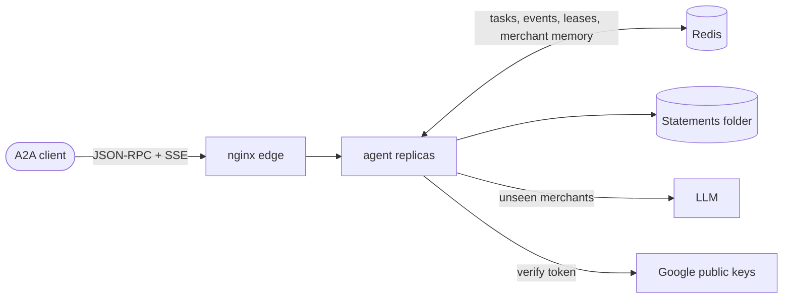

# cal-agent

cal-agent reads the monthly PDF statements of Cal (כאל, Israel Credit Cards) cards and serves
them to other programs, one person and one month at a time, with every charge categorized.
Another program, the caller, asks it over the open
[A2A (Agent2Agent) protocol](https://a2a-protocol.org) for one person's charges in one billing
month; in the demo it belongs to, the caller is the
[home finance agent](https://github.com/erancha/home-finance-agent), which reviews a household's
monthly spending across cards. A2A calls every party in the conversation an agent, hence the
name; inside, cal-agent is a fixed pipeline: read the month's statement, categorize its merchants,
stream the rows back. It serves many people through several callers, and runs as several
replicas that share their work.

**Contents:** [Overview](#overview) · [Tech stack](#tech-stack) · [Architecture](#architecture) ·
[Getting started](#getting-started) · [Scripts](#scripts) · [Details](#details) ·
[License](#license)

## Overview

- A caller asks for a billing month, such as October 2026, and receives every charge of that
  month's statement, each with its date, amount in shekels, a spending category such as
  `groceries` or `insurance`, and the agent's confidence in it: `high`, `medium` or `low`.
- The request is the agent's one skill, the operation an A2A agent advertises on its card:
  `monthly-transactions`. Its format is shared by every card agent, so a caller talks to any of
  them the same way; everything Cal-specific (the Hebrew PDF layout, installments, standing
  orders, purchases abroad) stays here.
- People load their own statement PDFs on a web page of the agent, after signing in with their
  Google account; each person sees and deletes only their own files.
- When the month's statement is not loaded yet, the agent asks for it and waits; once the person
  has loaded it, the caller continues the same request and gets the month.
- A month comes back whole or not at all: the rows are checked against the total the statement
  prints, and any difference fails the request.
- A language model only chooses categories, once per merchant and person; every amount and date
  is read from the PDF.
- Only callers registered by whoever runs cal-agent are served. Each caller signs the person in
  with Google on its own side and forwards that sign-in with every request, so the agent always
  knows both who asks and for whom.

## Tech stack

- **Service** — Python 3.14, FastAPI on uvicorn, structlog for logging
- **A2A** — the official `a2a-sdk` 1.x server: its routes and request handler, JSON-RPC requests
  and SSE streams
- **Model** — the Anthropic or OpenAI SDK, chosen by one setting, to categorize merchants
- **Statements** — pdfplumber reads the card site's PDF
- **Auth** — Google ID tokens checked with PyJWT; a secret per registered caller
- **Runtime** — Docker Compose: two replicas behind an nginx edge, sharing tasks, their events and
  the merchant memory through Redis, on the workstation or on one EC2 instance behind CloudFront
  (CloudFormation)
- **Tests** — pytest with Testcontainers, ruff, mypy and import-linter, a client-side
  validation, the official A2A conformance suite; GitHub Actions runs them

## Architecture

A caller's request reaches one of the replicas through the nginx edge. The replica checks the
caller's secret, sent in the `X-Caller-Secret` header, and the person's Google ID token, then
reads the month's statement from the statements folder, which holds a sub-folder per Google
account. It has a language model categorize the merchants it has not decided before, and streams
the rows back. Tasks, their events, the remembered merchant decisions and a lease naming the call
that runs each task live in Redis, so a paused task can be continued, or a running one followed,
through any replica, and a task runs only once.

**[Architecture](docs/architecture.md)** continues from here: the full diagram with each part
inside a replica, the boundaries between a card agent and its caller, and a page per subsystem.

## Getting started

The stack runs under Docker Compose, on this machine or on one EC2 instance behind CloudFront. It
needs Docker with Compose 2.24+; the tests also need Python 3.14, and the client-side validation
openssl.

1. Create the agent's own Google OAuth web client, with `http://localhost:8030` as its authorized
   JavaScript origin, and add your Google account as a test user
   ([Sign-in](docs/sign-in.md#setting-up-google) walks the console).
2. Run `./scripts/deploy.sh`. The first run creates the gitignored settings files under
   `scripts/lib/` from their `.example.sh` files, which explain each setting, then stops and
   names each setting left to fill in: the client id as `AUTH_CLIENT_ID` in `params.sh`, and the
   Anthropic or OpenAI key of the model `LLM_MODEL` names as `LLM_API_KEY` in `secrets.sh`.
3. Register each caller by its name and the Google client id of the caller's own sign-in, which
   the caller's operator hands you; the agent refuses to start without one. The command prints
   what that operator needs back: the agent's name, its A2A URL, its statements page and the
   secret, shown once:
   `./scripts/tools/register-caller.sh --name <caller> --client-id <client id>`.
4. Run `./scripts/deploy.sh` again. It builds the images, starts the stack on
   http://localhost:8030 and returns once the agent answers.
5. Load a statement PDF on http://localhost:8030/statements.html; it is stored as its billing
   month, such as `2026-10.pdf`, in your own folder under `statements/`. The registered caller
   can now ask for that month.
6. To run the stack on AWS instead, on an EC2 instance behind a CloudFront distribution of its own,
   run `./scripts/deploy.sh --ec2`: on an instance of its own, or as a guest on another Docker
   Compose repo's instance when `EC2_HOST_STACK` of `params.sh` names that repo's stack. It also
   names the access key pair and region to fill in in `aws-config.sh`, and at the end prints the
   CloudFront address to add to the Google client, where the statements page loads statements on the
   instance ([Development & deployment](docs/development.md#deployment-scripts-scripts)).

`./scripts/test.sh` runs the checks and the tests; none needs a model key or reaches Google.
[Development & deployment](docs/development.md) has the settings, the client-side validation
that proves the agent without any real caller, and the gotchas.

## Scripts

- `init-env.sh` — creates the gitignored settings files under `scripts/lib/`; `deploy.sh` runs it
  first
- `test.sh` — the scripts' syntax, lint, type and layer checks, the unit tests and, by default,
  the integration tests
- `deploy.sh` — builds and starts Redis, two replicas and the nginx edge in Docker; `--ec2` does
  it on an EC2 instance behind CloudFront
- `docker-helper.sh` — stops the stack, follows its logs or shows its containers

Each script's header comment is its full documentation, and `--help` prints it.

## Details

- [Architecture](docs/architecture.md) — the Compose services, the boundaries, a summary per
  subsystem, the edge on EC2, storage and the codebase
- [API endpoints](docs/api.md) — every route of the agent, who may call it and what it answers
- [Workers' responsibilities and flows](docs/workers.md) — the lease sweep each replica runs
- [A2A contract](docs/a2a-contract.md) — what cal-agent puts on the wire for the shared skill
- [Request flow](docs/architecture/request-flow.md) — a request through the stack and inside a
  replica: the credentials, the admission and the executor
- [Statements](docs/architecture/statements.md) — the folder per person, how the Cal PDF is read,
  and the statements page
- [Categorizer](docs/architecture/categorizer.md) — the merchant memory, the prompt and the
  providers
- [Scaling](docs/architecture/scaling.md) — what the replicas guarantee and the edge service
- [Design patterns](docs/design-patterns.md) — the layers of the package and how they are
  enforced
- [Data model](docs/data-model.md) — every Redis key, the statements root and the callers registry
- [Sign-in](docs/sign-in.md) — setting up the Google side of the page's and the callers' sign-ins
- [Development & deployment](docs/development.md) — the settings files, the tests, the
  scripts, the EC2 stack, registering a caller, loading statements and the gotchas
- [Testing](docs/testing.md) — what each test layer proves
- [Decisions](docs/adr/) — one record per founding decision and why it was made: the SDK,
  the replicas, the statements, sign-in, the model's role, the layers and EC2

## License

Source-available under the [PolyForm Noncommercial License 1.0.0](LICENSE). Reading the source,
forking it and running a private deployment are free for anyone, companies included —
[NOTICE](NOTICE) grants that explicitly for evaluating the project or its author. Building a
commercial product or service on it needs a commercial license: erancha@gmail.com.

---
More projects by the author: [github.com/erancha](https://github.com/erancha)
