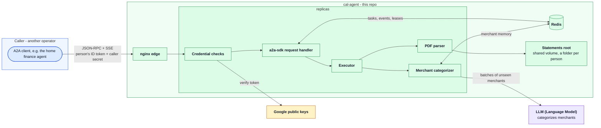

# cal-agent

[](https://github.com/erancha/cal-agent/actions/workflows/ci.yml)

cal-agent is a multi-user, scalable service for Cal (כאל, Israel Credit Cards) cards. Another
program asks it, over the open [A2A (Agent2Agent) protocol](https://a2a-protocol.org), for one
person's charges in one month and gets them back categorized. The caller is typically an agent
that reviews a household's monthly spending across cards.

A2A calls every party in the conversation an agent, hence the name. Inside, cal-agent is a fixed
pipeline: read the month's statement, categorize its merchants, stream the rows back.

**Contents:** [Architecture](#architecture) · [Boundaries](#boundaries) ·
[Getting started](#getting-started) · [Scripts](#scripts) · [Testing](#testing) ·
[License](#license)

## Architecture



A request walks the diagram left to right:

- **A2A client**, the caller, reads cal-agent's Agent Card, checks it offers the skill, and asks
  for a billing month, for example `{"month": "2026-10"}`, sending its registered secret and the
  signed-in person's Google ID token, so cal-agent knows which caller asks and for whom.
- **nginx edge** spreads requests over the replicas; everything listed below runs inside the
  replica that got the request.
- **Credential checks** admit the call only when it carries a secret the agent issued to a
  registered caller, and verify the person's token against **Google public keys**.
- **a2a-sdk request handler**, the official A2A server library for Python, turns the call into a
  task. The task and each of its events are kept in **Redis**, so a task paused by one replica can
  be continued through any, and a running task can be followed from any. A lease in Redis names
  the replica running each task, so a task runs once even when two requests race for it.
- **Executor** is this repo's card work: have the **PDF parser** read that month's statement from
  the person's own folder in the **statements root**, and have the **Merchant categorizer** label
  the merchants, asking the **LLM** (Anthropic's or OpenAI's) only about merchants it has not
  decided for this person before; its decisions are remembered in Redis. The charges stream back
  along the same path in batches, each with a category such as `groceries` or `insurance`. When
  the statement is not loaded yet, the executor leaves the task open and asks for it; once the
  person has loaded the file, the caller says "continue" and the same task finishes. A token that
  has expired pauses the task the same way until the person signs in again.

The LLM only chooses categories; every amount and date is read from the PDF. A month comes back
whole or not at all: the parser checks its rows against the total the statement prints and fails
the request on any difference.

Details and decisions: [docs/architecture.md](docs/architecture.md); what it puts on the wire:
[docs/a2a-contract.md](docs/a2a-contract.md).

**Stack:** Python 3.14, FastAPI, a2a-sdk, pdfplumber, PyJWT, the Anthropic and OpenAI SDKs,
Redis, nginx, Docker.

## Boundaries

- **The contract is shared, not per agent.** Every card agent should offer the same A2A skill,
  `monthly-transactions`: a billing month in, rows out in one format (ISO dates, amounts in
  shekels, one category from a closed list), or a request for the missing statement. The caller
  owns that contract; [docs/a2a-contract.md](docs/a2a-contract.md) describes how cal-agent
  implements it.
- **Each card agent normalizes and categorizes its own card, so a caller needs nothing
  card-specific.** Everything Cal-specific stops here: the PDF layout, Hebrew labels, cells that
  wrap onto a second line, installments, standing orders, purchases from merchants abroad. Rows
  leave cal-agent in the shared format, each in a category with the agent's confidence, `high`,
  `medium` or `low`, or `uncategorized` when it cannot tell. A caller can talk to any card agent
  that offers the skill, and owns only what spans cards: the person's own categories (which
  outrank any card agent's), the budget, the totals and the summary.

## Getting started

Requires **Docker** with Compose 2.24+ for the default run, **Python 3.14** for tests, host mode
and `validate.sh`, and **openssl** for `validate.sh`.

1. **The env file.** `./scripts/init-env.sh` writes `.env`; every key in it is explained in
   [.env.example](.env.example). The next two steps fill in the two it needs. A caller calls the
   URL the card advertises, `AGENT_URL`; for a caller running in Docker on this machine set it to
   `http://host.docker.internal:8030`, since `localhost` there is the caller's own container. The
   scripts treat `.env` as defaults: a variable already exported in the calling shell wins over
   the same key there.
2. **A Google OAuth client of its own**, set up as [docs/sign-in.md](docs/sign-in.md) describes;
   its client id goes into `.env` as `AUTH_CLIENT_ID`.
3. **A language model key**, Anthropic's or OpenAI's, as `LLM_API_KEY`. `LLM_MODEL` names the
   model as `provider:model`; `.env.example` sets Anthropic's `claude-haiku-5-5`.
4. **Register a caller.** A program that calls the A2A skill is registered by its name and the
   Google client id of its own sign-in, whose tokens it forwards; its operator hands you that id.
   The agent refuses to start without a caller, and `start.sh` stops early to say so:

   ```bash
   ./scripts/register-caller.sh --name <caller> --client-id <the caller's client id>
   ```

   The registration prints the four values the caller's operator records: this agent's name,
   `cal`, its A2A URL, its statements page URL and the secret, shown once. Hand them over.
   Registering another caller later takes a restart: the agent reads the file at startup.
5. **Start:**

   ```bash
   ./scripts/start.sh             # builds the image, starts the replicas on http://localhost:8030
   ./scripts/validate.sh          # runs its own copy on :8031 and proves it as an A2A client would
   ```

   `start.sh` ends by repeating the three public values of the hand-over: this agent's name, the
   advertised URL and the statements page's URL.
6. **Statements.** Download each monthly statement PDF from the Cal site and load it on the
   statements page, **http://localhost:8030/statements.html**: sign in with your Google account,
   and the page lists the statements you loaded, deletes one on request and stores each upload
   under its billing month whatever the file is called, in a folder of your own under
   `statements/` (git ignores the folder). A statement's billing month is the month the card is
   charged, printed in its title: the statement charged on 2 October 2026 is stored as
   `2026-10.pdf` and answers a request for `2026-10`. The page only loads files; everything about
   the month's spending happens in the caller.

`LLM_MODEL=keyword` replaces the model with a built-in keyword table that needs no key; the tests
and `validate.sh` run that way.

## Scripts

All live in `scripts/`; run with `--help` for full usage.

| Script | Purpose |
|---|---|
| `init-env.sh` | Create `.env`; `--force` overwrites. |
| `register-caller.sh` | Register an A2A caller (name, secret, Google client id) in `allowed-callers.yaml`, or replace its entry. |
| `start.sh` | Run the agent in Docker, or `--host` as one local process. |
| `docker-helper.sh` | `--stop [--volumes]`, `--logs [-e] [service...]` or `--ps` for the Docker run; `--volumes` also drops the paused tasks. |
| `test.sh` | Run the checks, unit tests and the scripts' own tests (`unit`), or those and the integration tests (`it`, `all`, the default). |
| `validate.sh` | Start cal-agent against its test statement with a throwaway signing key and prove it end to end as a registered A2A caller; `--tck` also runs the official A2A conformance suite. |
| `lock.sh` | Recompile `requirements.txt`, the pinned dependencies, inside the image's Python. |
| `anonymize-statement.py` | Copy a statement PDF with the holder's private details replaced, to use as a test fixture. |

## Testing

```bash
./scripts/test.sh              # checks, unit and integration tests; the Redis ones need Docker
```
What each layer covers is in [docs/testing.md](docs/testing.md).

## License

Released under the MIT License. See [LICENSE](LICENSE).

---
More projects by the author: [github.com/erancha](https://github.com/erancha)
