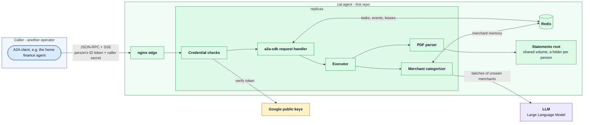

# Architecture

This document details how cal-agent is built, behind the [README](../README.md)'s Architecture
section. Each section below ends in a page that holds its details. What goes on the wire is in
[a2a-contract.md](a2a-contract.md); how each part is tested is in [testing.md](testing.md); how
to run it is in [development.md](development.md). The founding decisions are recorded in
[adr/](adr/).

**Contents:** [The parts](#the-parts) · [Boundaries](#boundaries) ·
[Request flow](#request-flow) · [Statements](#statements) · [Categorizer](#categorizer) ·
[Scaling](#scaling) · [Configuration](#configuration) · [Deployment](#deployment) ·
[Storage](#storage) · [Codebase structure](#codebase-structure)

## The parts

A request walks the diagram left to right:

- **A2A client**, the caller, reads cal-agent's Agent Card, checks it offers the skill, and asks
  for a billing month, for example `{"month": "2026-10"}`, sending its registered secret and the
  signed-in person's Google ID token, so cal-agent knows which caller asks and for whom.
- **nginx edge** spreads requests over the replicas; everything listed below runs inside the
  replica that got the request.
- **Credential checks** admit the call only when it carries a secret the agent issued to a
  registered caller, and verify the person's token against **Google public keys**.
- **a2a-sdk request handler**, the official A2A server library for Python, turns the call into a
  task. The task and each of its events are kept in **Redis**, so a task paused by one replica can
  be continued through any, and a running task can be followed from any. A lease in Redis names
  the replica running each task, so a task runs once even when two requests race for it.
- **Executor** is this repo's card work: have the **PDF parser** read that month's statement from
  the person's own folder in the **statements root**, and have the **Merchant categorizer** label
  the merchants, asking the **LLM** (Anthropic's or OpenAI's) only about merchants it has not
  decided for this person before; its decisions are remembered in Redis. The charges stream back
  along the same path in batches, each with a category such as `groceries` or `insurance`. When
  the statement is not loaded yet, the executor leaves the task open and asks for it; once the
  person has loaded the file, the caller says "continue" and the same task finishes. A token that
  has expired pauses the task the same way until the person signs in again.

The LLM only chooses categories; every amount and date is read from the PDF. A month comes back
whole or not at all: the parser checks its rows against the total the statement prints and fails
the request on any difference.

## Boundaries

- **The contract is shared, not per agent.** Every card agent should offer the same A2A skill,
  `monthly-transactions`: a billing month in, rows out in one format (ISO dates, amounts in
  shekels, one category from a closed list), or a request for the missing statement. The caller
  owns that contract; [a2a-contract.md](a2a-contract.md) describes how cal-agent implements it.
  The agent serves it through the official A2A SDK rather than a protocol layer of its own
  ([ADR 0001](adr/0001-a2a-server-on-the-official-sdk.md)).
- **Each card agent normalizes and categorizes its own card, so a caller needs nothing
  card-specific.** Everything Cal-specific stops here: the PDF layout, Hebrew labels, cells that
  wrap onto a second line, installments, standing orders, purchases from merchants abroad. Rows
  leave cal-agent in the shared format, each in a category with the agent's confidence, `high`,
  `medium` or `low`, or `uncategorized` when it cannot tell. A caller can talk to any card agent
  that offers the skill, and owns only what spans cards: the person's own categories (which
  outrank any card agent's), the budget, the totals and the summary.

## Request flow

[architecture/request-flow.md](architecture/request-flow.md) is what runs inside a replica: how
the two credentials are checked, how a request is admitted before its task starts, and how the
official A2A SDK's routes and request handler carry the stream. A caller is admitted by a
secret the agent issued it, and the person by a Google ID token the caller forwards
([ADR 0004](adr/0004-google-identity-and-registered-callers.md)).

## Statements

One folder per person under the statements root, where a static page lets a person load and
delete their own files. On every lookup the agent reads the folder's PDFs and maps each to the
billing month it declares, so a file loaded while a task waits is found on `continue`. The parser
reads the Hebrew right-to-left table by word positions and checks the rows against the printed
total. The person loads each statement; the agent never logs in to the card site
([ADR 0003](adr/0003-statements-loaded-by-the-person.md)).
[architecture/statements.md](architecture/statements.md)

## Categorizer

A language model categorizes each merchant once per person, in batches, guided by the sector label
the statement prints, and its score becomes `high`, `medium` or `low` confidence. Decisions are
remembered in Redis, so a repeated month costs no model call on any replica. Amounts and dates
never pass through the model ([ADR 0005](adr/0005-model-only-categorizes-merchants.md)).
[architecture/categorizer.md](architecture/categorizer.md)

## Scaling

The Docker stack runs several replicas of the agent behind an nginx edge. They share through Redis
the A2A tasks and their events, on the task store and event stream interfaces the A2A SDK defines
for running over replicas, and parts of the agent's own: a lease naming the call that runs each
task, and the merchant memory. The concerns that follow are each a GitHub label beside
`scalability`:
**scaling safety**, that it is safe to run more than one replica without errors; and **scaling
out**, that adding replicas serves more callers without degrading any caller's experience.
Replicas under Docker Compose sharing Redis are the founding runtime
([ADR 0002](adr/0002-replicas-sharing-redis-under-docker-compose.md)).
[architecture/scaling.md](architecture/scaling.md)

## Configuration

Every runtime setting is an environment variable, which the scripts export from three files under
`scripts/lib/`: the committed `stack-params.sh`, and the gitignored `params.sh` (this deployment's
model and Google client) and `secrets.sh`. Compose hands each replica only the keys the agent
reads. Secrets, the model and the statements folder have no default, and a wrong required setting
stops startup naming it. [architecture/configuration.md](architecture/configuration.md)

## Deployment

`./scripts/deploy.sh` runs the Compose stack on the workstation, where the edge publishes port
8030 and the statements folder is a folder of the repo. `./scripts/deploy.sh --ec2` runs the same
stack on loan-simulator's EC2 instance, as a guest stack of the shared CloudFormation template,
`scripts/template-ec2.yaml`: it opens port 8030 to CloudFront's servers and adds a CloudFront
distribution whose https address is the way in, and which the card advertises there
([ADR 0007](adr/0007-guest-on-loan-simulators-ec2-instance.md)). The images are built on the
deployer's machine for ARM and loaded into the instance's Docker daemon over SSH, and Compose runs
there against that daemon, so nothing is bind-mounted from the deployer's machine: the edge's
configuration is part of its image, Compose copies the callers registry into each replica, and on
the instance the statements live in the `cal_statements` volume. `docker-compose.ec2.yml` holds
what differs there.

## Storage

- **Redis**, shared by the replicas: a hash per task, `cal:task:<id>`, with the set of task ids
  `cal:tasks`; a stream of each task's events, `cal:events:<id>`; a lease per running task,
  `cal:lease:<id>`; and the merchant memory, a hash per person, `cal:merchants:`. A
  task expires `TASKS_TTL` after its last save, the memory never. Redis writes an append-only
  file every second to the `cal_redis` volume ([architecture/scaling.md](architecture/scaling.md)).
- **The statements root**, `STATEMENTS_DIR` (`./statements` in `stack-params.sh`), mounted into
  every replica, or the `cal_statements` volume on the EC2 instance: a folder per Google account
  id, each PDF named for its billing month
  ([architecture/statements.md](architecture/statements.md)).
- **`allowed-callers.yaml`**, the gitignored callers file `tools/register-caller.sh` writes,
  which Compose copies into each replica and the replica reads at startup: each caller's name,
  secret and Google client id.

## Codebase structure

One package in layers: the domain values at the center, the ports the card work depends on, the
month pipeline, the adapters to the outside world, and the platform that fits it all into the A2A
SDK and FastAPI. `lint-imports` enforces the layers
([ADR 0006](adr/0006-layered-package-enforced-by-import-linter.md)).
[architecture/codebase-structure.md](architecture/codebase-structure.md)
