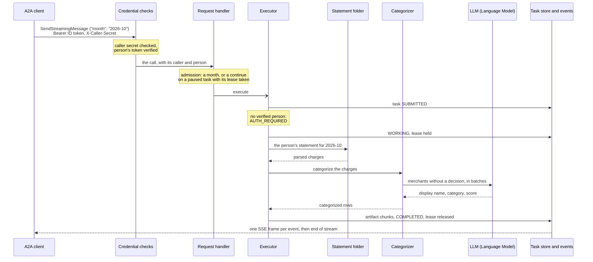

# Request flow

What happens inside one replica between a caller's request for a month and the last row it
receives, and why the agent is built that way.

The executor never writes to the HTTP response. It emits task events; the A2A SDK's request
handler saves each one to the task store, publishes it to the task's event stream, and its routes
turn the events into SSE frames. Because every event passes through the store and the stream, a
task paused on one replica can be continued on another, and a task running on one can be followed
from another ([scaling.md](scaling.md)). The SDK requires the task itself as the first event, so
the executor emits the new task before any status.

## The SDK's routes

The official A2A Python SDK (`a2a-sdk`) ships the JSON-RPC route, with SSE streaming, and the
agent-card route for FastAPI, and the agent mounts both. Its request handler turns a call into a
task, runs the executor for it, and keeps a version on each task, so a write based on a stale read
is refused. The agent's own code is the executor, the admission rules below, the credential checks
and the statements routes beside them; nothing of the transport is hand-written.

Only `SendStreamingMessage` serves the skill. The skill's whole design is a stream, chunks as they
are ready and then possibly a pause, and a `continue`'s lease is handed from the admission check
to the run on that stream; the blocking `SendMessage` is refused.

## Who is calling

Every request is for a person, and most arrive through a caller acting for that person. The agent
knows them from two credentials, checked in two places:

- **The caller**, by the shared secret in `X-Caller-Secret`. A middleware in front of the JSON-RPC
  route compares it in constant time against every registered caller and answers 401 when none
  matches; the card, the health route and the statements page pass untouched. Callers are entries in
  `allowed-callers.yaml`, which `register-caller.sh` writes: a name, the secret, and the Google
  OAuth client id of the caller's own sign-in. The agent reads the file at startup, so removing an
  entry revokes the caller from the next start. Startup refuses an empty file, a blank field, and
  two callers sharing a secret or a name.
- **The person**, by the Google ID token in `Authorization`, which the caller forwards as the
  person's browser received it. The call-context builder, a subclass of the SDK's own, checks the
  signature against Google's published keys, the issuer, the expiry and the audience, which must
  equal the admitted caller's registered client id: a token issued to any other client, this agent's
  own included, is refused. The token's `sub` is the person's id everywhere in the agent.

The call-context builder never rejects a request. It records the verified person, or why there is
none, and the executor acts on it after the task is submitted and before any work, so a failed
check is a task state the caller can act on rather than an HTTP refusal: the task pauses in
`TASK_STATE_AUTH_REQUIRED`, the caller has the person sign in again and continues the same task.
Each pause records the person, and a `continue` by another Google account is answered the same
way. With auth off neither credential is read and every request is for `anonymous`.

The SDK scopes tasks by the user on the call context, and that user is the caller, not the person.
A caller sees only its own tasks; a person who continues a task through the right caller finds it
and is answered with sign-in-required rather than task-not-found, which is the answer the contract
asks for. Since ownership is keyed on the caller's name, two registered callers never share one.

The statements page is the other way in. It signs in with this agent's own Google client
([sign-in.md](../sign-in.md)), and its API accepts only tokens issued to that client. A person
uploads into, lists and deletes from the folder of their own `sub`; nobody else's folder is
reachable, and an id shaped like a path is refused before it becomes one.

The agent honors a Google token that was issued to a partner's client. That is the trust two
services under one roof place in one identity provider; an agent operated by a separate company
would more likely issue tokens of its own after verifying the person (OAuth 2.0 token exchange).

## Admission before the task starts

The SDK stores a task as `TASK_STATE_FAILED` whenever the executor raises, so a request that must
be refused is refused before the SDK creates or resumes a task, in a subclass of the SDK's request
handler:

- A message without a `taskId` must ask for a billing month in the shape the contract gives;
  anything else is `InvalidParams`, and no task exists afterwards.
- A message naming a task must be a `continue`, on a task waiting for input or sign-in, and must
  take the task's lease. Of two continues sent at once only the first takes it; the other is
  refused as already running.

Each call takes and releases leases under an owner of its own, the replica's identity plus a call
id, so a call releasing its lease can never drop one that a later call on the same replica holds.
Once the SDK starts the run, releasing the lease is the executor's job, when the task pauses,
completes or fails. The handler releases it only when the SDK refuses the message before any event,
since no run then exists. A caller that leaves mid-request releases nothing: the SDK may still run
the task, so the lease stays with that run, or expires with its time to live. Because the SDK may
start a continued run after the lease's time to live has passed, the executor first renews the
lease: it takes a lapsed lease again, and when another call holds it, it ends without any event,
leaving the task as that call runs it.

## The executor

For a new task the executor emits the task, checks the person, takes the lease and emits
`TASK_STATE_WORKING`; for a continue it reads the month and the person back from the task's pause
message and does the same with the lease the handler took. It then fetches the month: the
statement found and parsed, the merchants categorized, the rows streamed in chunks of 25 on one
artifact, and `TASK_STATE_COMPLETED`. While it works it renews the lease every third of the lease
period, and losing the lease stops the work and fails the task: no replica takes over a working
task, and the sweep fails a working task that holds no lease. A missing statement pauses the
task; a statement, categorizer or model failure is raised with its cause, and the SDK fails the
task with that text.

Every replica runs on one event loop. The model clients are asynchronous, so one task's wait for
the model never holds up another's stream, and the statement lookup a task makes, which can parse a
PDF, runs on a worker thread, as do the statements API's file reads and writes.

After a task enters an interrupted state the SDK delivers the queued events and ends the stream,
so a task that waits for a statement holds no connection while a person downloads a file.
